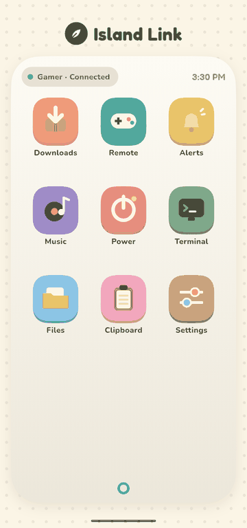
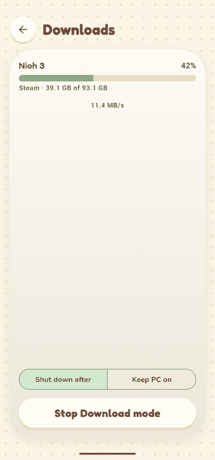
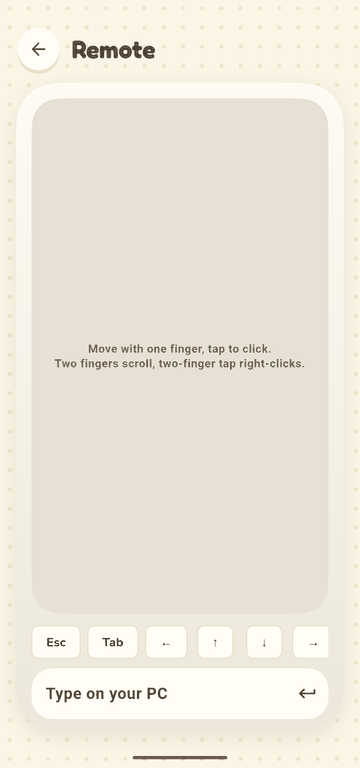
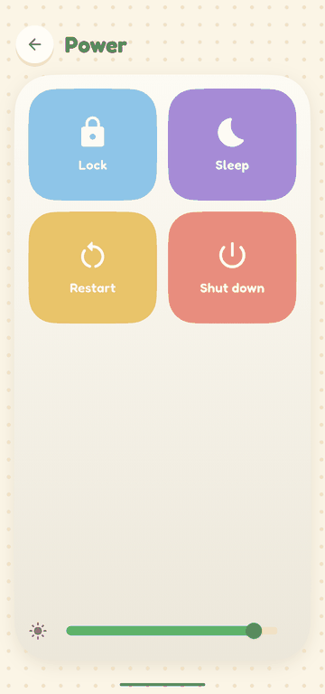
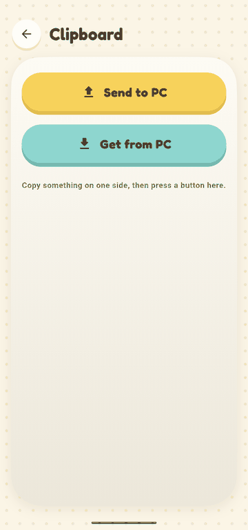
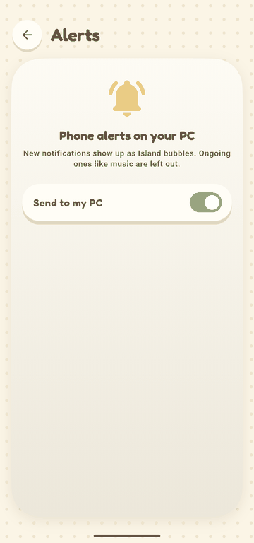

# island-link-android

Pixel / Android side of **Island Link**: a light phone ↔ PC link for the Island shell (Hyprland, CachyOS).

  
  
  

  
  
  

- Phone notifications → Island bubbles on the PC
- Download mode: live progress bar in a notification, what-happens-after buttons, a countdown before the PC shuts down
- Remote: touchpad and keyboard for the PC
- Music, volume, brightness, lock, sleep, restart, shut down
- Clipboard both ways, files with Share → Island Link
- Terminal: one visible kitty on the PC, mirrored here, behind your fingerprint

Flutter (Dart) app, with a small native Android part for the always-on pieces. No Google Play Services. Pairs once by QR code with the PC helper:
[island-link-pc](https://github.com/minhtriet199/island-link-pc). Same Wi-Fi only for now.

Status: just started.
